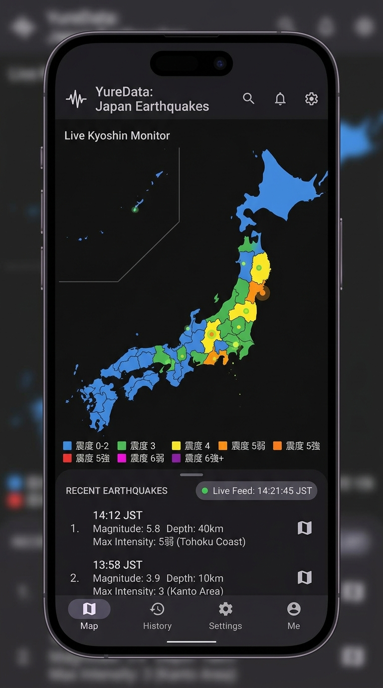
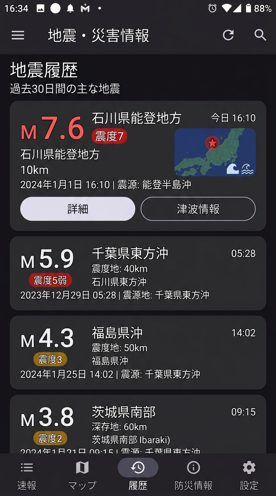
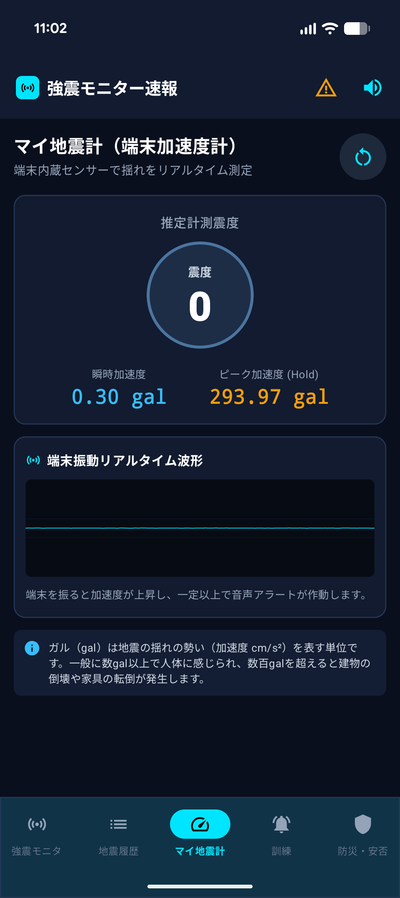
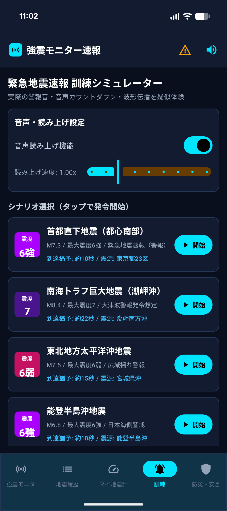
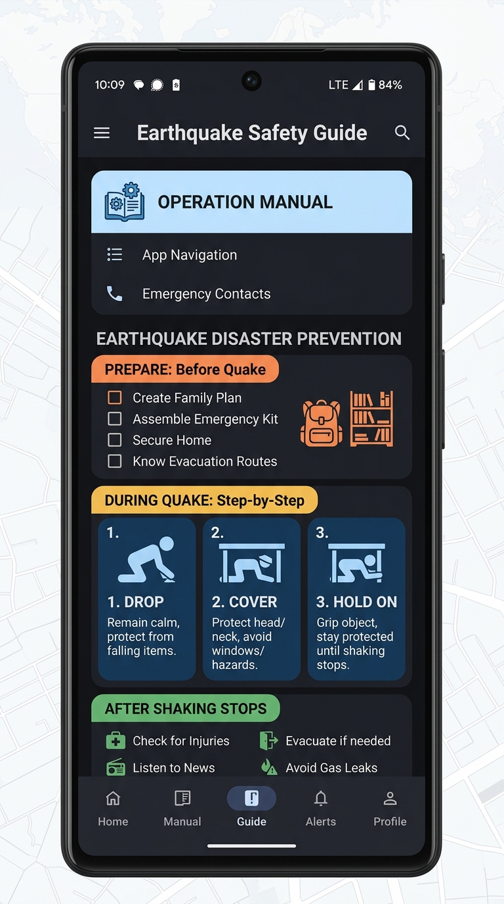

# 強震モニター (Kyoshin Monitor & Earthquake Tracker)

<p align="center">
  
  
  
</p>

「強震モニター」は、リアルタイムの強震モニタ画像、全国観測点リアルタイム震度オーバーレイ、気象庁およびP2P地震情報APIによる地震履歴・緊急地震速報（EEW）の受信、デバイスの加速度センサーを用いた本格マイ地震計、そして見やすく使いやすい防災訓練モードを提供するAndroid向け総合地震・防災アプリケーションです。

最新の **Jetpack Compose** と **Material Design 3** を全面的に採用し、直感的で洗練されたUI、スリープ時にも届く強固なバックグラウンド監視、そして迅速な音声読み上げを実現しています。

---

## 📥 APKダウンロード (Download APK)

Android実機に直接インストールしてご利用いただける最新デバッグAPK（**v1.0.5**）の配布情報です。  
スマートフォンから直接ダウンロードされる方は「**APK直接ダウンロード**」ボタンをタップしてください。PC等からご覧の方は、スマートフォンカメラで右側のQRコードをスキャンしてダウンロードできます。

<div align="center">

| 📲 最新リリース: **v1.0.5** (デバッグ版) | 📷 スマホ用スキャンQRコード |
| :---: | :---: |
| <br/>[-00C853?style=for-the-badge&logo=android&logoColor=white)](https://github.com/Chip-kun/Strong-Earthquake-Monitor/releases/download/V1.0.5/KyoshinMonitor-debug.apk)<br/><br/>**[🔗 https://github.com/Chip-kun/Strong-Earthquake-Monitor/releases/download/V1.0.5/KyoshinMonitor-debug.apk](https://github.com/Chip-kun/Strong-Earthquake-Monitor/releases/download/V1.0.5/KyoshinMonitor-debug.apk)**<br/><br/>📁 **ファイル名**: `KyoshinMonitor-debug.apk`<br/>🔖 **バージョン**: `v1.0.5`<br/>🤖 **対応OS**: Android 8.0（API 26）以上<br/>⚡ **v1.0.5 主なアップデート**: <br/>・リアルタイム震度観測点マップオーバーレイ機能（地表・地中観測点切替対応）<br/>・防災訓練画面「シナリオ選択（タップで発令開始）」の高コントラスト視認性向上＆カード全体タップ起動<br/>・24時間常駐バックグラウンド監視（Foreground Service & WorkManager）によるスリープ時の確実なアラート通知<br/>・マイ地震計オシログラフ・FFT周波数解析の安定性向上<br/><br/> | <br/><br/><sub>スマートフォンのカメラで読み取ってダウンロード</sub><br/><br/> |

</div>

### 📲 インストール手順 (簡単3ステップ)

1. **APKのダウンロード**:
   - 上記の「**[APK直接ダウンロード](https://github.com/Chip-kun/Strong-Earthquake-Monitor/releases/download/V1.0.5/KyoshinMonitor-debug.apk)**」リンクまたはQRコードから `KyoshinMonitor-debug.apk` をダウンロードします。
2. **提供元不明のアプリの許可**:
   - Chrome等のブラウザからダウンロード後、インストール時に「提供元不明のアプリ」または「この提供元からのアプリを許可」と表示された場合は、画面の案内に従ってトグルを「**許可（ON）**」に設定してください。
3. **インストール完了と権限設定**:
   - 「**インストール**」をタップして完了したらアプリを起動します。
   - 初回起動時に**通知の許可**（緊急地震速報の通知用）および**位置情報の許可**（震源地からの距離算出用）を「許可」にしてご利用ください。

> ℹ️ **Google Playプロテクトの警告が表示された場合**:  
> 本APKはGitHub Releaseから直接配布されるデバッグ署名済みバイナリです。「Playプロテクトによりブロックされました」と表示される場合は、「**詳細**」をタップし「**このままインストールする（安全ではないアプリをインストール）**」を選択して進めてください。

---

## 🌟 主な機能と特徴

### 1. 24時間 常駐バックグラウンド監視 (`Foreground Service` & `WorkManager`)
- **アプリ終了時・画面スリープ時も確実に通知**: Android Foreground Serviceを採用し、アプリを閉じた状態でも24時間リアルタイムに気象庁・P2P地震速報を監視。
- **高優先度ヘッズアップ通知**: 地震発生や緊急地震速報の検知時に即座に大音量チャイム・バイブレーション・ヘッズアップ通知を発令。
- **音声自動読み上げ**: 画面を開いていなくても、設定した読み上げ速度で震源地や最大震度を音声アナウンス。
- **端末再起動後の自動復旧**: 端末の再起動時（`BOOT_COMPLETED`）にも自動的に監視サービスが立ち上がります。

### 2. WebSocket リアルタイム配信 & 防災科研 (NIED) 画像定期取得
- **WebSocket リアルタイム常時接続 (`KyoshinWebSocketClient`)**:
  - P2P地震情報 WebSocket ストリーム（`wss://api.p2pquake.net/v2/ws`）に常時接続。
  - 緊急地震速報（Code 556）や地震情報（Code 551）、津波予報（Code 552）をミリ秒単位の即時プッシュで受信。
  - 切断時の指数バックオフ自動再接続、ハートビートKeep-Alive、接続ステータス・受信件数モニターを完備。
  - フォアグラウンドサービス内でもバックグラウンド監視と連動し、即時通知と音声読み上げを発令。
- **防災科研 (NIED) 強震モニタAPI 定期取得 (`KmoniImageFetcher`)**:
  - 防災科学技術研究所の強震モニタAPI（`http://www.kmoni.bosai.go.jp/`）から1秒周期でリアルタイム画像を定期取得。
  - リアルタイム震度（`jma`）・最大加速度 PGA（`acmap`）・最大速度 PGV（`vcmap`）・最大変位 PGD（`dcmap`）に対応。
  - 地表観測点（`_s`）および地中ボアホール観測点（`_b`）のワンタップ切り替えに完全連動。
  - JST時刻同期とサーバー遅延（1〜3秒）の動的補正ロジックを搭載し、途切れのない最新画像表示を実現。
  - モニタ画面で「**強震網**（ベクトル観測網）」「**JMA震度**（色分け等震度マップ）」「**防災科研**（公式リアルタイムGIF画像）」をシームレスに切り替え可能。

### 3. 緊急地震速報 (EEW) & 詳細音声アナウンス
- 緊急地震速報（警報・予報）の受信時にアラートバナーを表示し、チャイム音とともに詳細な音声読み上げ（TTS）を実施。
- 発生時刻、震源地、深さ、マグニチュード、推定最大震度、および影響を受ける対象地域（都道府県・市町村）をきめ細かくアナウンス。
- 読み上げ速度の微調整や、設定画面からのワンタップテスト発声に対応。

### 4. 地震履歴・詳細レポート (P2P地震情報連携 & Room永続化)
- 過去の地震発生履歴を一覧表示。各地震をタップすると、震度ごとの観測市区町村リストや津波情報の有無まで網羅した詳細レポートを確認できます。
- 地震詳細や履歴項目からも、詳細な音声読み上げをワンタップで実行可能。

### 5. 過去震源地 履歴マップ機能 (Roomローカルデータベース連携)
- Roomデータベースに蓄積された過去の地震・EEW速報ログを元に、日本地図上に過去の震源地をグラフィカルにプロット。
- ピンチズームやドラッグ操作に対応し、マグニチュード規模（円のサイズ）および最大観測震度（色分け）を視覚的に振り返ることが可能。
- 規模（M5+ / M6+ / M7+）や震度（震度4+ / 5弱+ / 6弱+）、警報フラグによるフィルタリング機能および地図スタイル切り替え（衛星地形/レーダー/海溝プレート）を完備。

### 6. 簡易マイ地震計 (端末加速度センサー活用)
- スマートフォンの内蔵3軸加速度センサーを利用して、周囲の揺れや微動をリアルタイムに検知・グラフ化。
- X軸・Y軸・Z軸のリアルタイム波形オシログラフ、ピーク加速度（Peak Accel）、FFT周波数スペクトル解析、振動レベル判定を搭載。

### 7. 緊急地震速報・防災訓練モード (`Drill`)
- 緊急地震速報のシミュレーション訓練をいつでも発令可能。実際の警戒音や音声読み上げの流れを体験し、万が一のときに備えることができます。
- **視認性向上**: 「シナリオ選択（タップで発令開始）」ヘッダーを鮮明な高コントラストデザインに強化。各シナリオカード全体をタップするだけで直感的に訓練を開始できます。

### 8. 防災ガイド & 操作マニュアル
- 地震発生前の備え、揺れ発生時の「まず低く・頭を守り・動かない（Drop, Cover, Hold On）」、揺れが収まった後の行動指針を視覚的なピクトグラムとともにわかりやすく解説。
- 緊急連絡先一覧やアプリの操作方法をいつでも確認できます。

---

## 📱 スクリーンショット

| リアルタイム強震モニタ | 地震履歴・詳細 | マイ地震計 (波形オシログラフ) |
| :---: | :---: | :---: |
|  |  |  |

| 緊急地震速報 防災訓練モード | 操作マニュアル・防災ガイド |
| :---: | :---: |
|  |  |

---

## 🛠 技術スタック

- **言語**: Kotlin
- **UIフレームワーク**: Jetpack Compose (Material Design 3)
- **非同期処理**: Kotlin Coroutines & Flow
- **バックグラウンド処理**: Android Foreground Service & WorkManager
- **ネットワーク**: Retrofit / OkHttp (P2P地震情報API / 強震モニタ画像取得)
- **ローカルデータベース**: Room Database (地震通知ログ・設定の永続化)
- **音声合成**: Android TextToSpeech (TTS) + カスタム VoiceAlertManager
- **センサー**: Android Sensor API (3軸加速度センサー)
- **アーキテクチャ**: MVVM (Model-View-ViewModel)

---

## 🚀 ビルド・開発方法

Android Studio（Hedgehog以降推奨）またはGradleコマンドを使用してビルドできます。

### 前提条件
- Android SDK (API 34以上推奨、最小API 24)
- Kotlin 1.9+

### ビルドコマンド
```bash
# デバッグAPKのビルド
gradle assembleDebug

# 単体テストの実行
gradle :app:testDebugUnitTest
```

---

## 📄 ライセンス

本アプリケーションはオープンソースとして公開されています。詳細についてはリポジトリ内のライセンスファイルをご確認ください。

---

> **免責事項**: 本アプリは防災科学技術研究所の強震モニタおよび各種オープンAPIの情報を利用して提供するものです。回線状況やサーバーのメンテナンス等により、速報の遅延や表示エラーが発生する場合があります。公式の気象庁発表情報や自治体からの指示を必ずご確認ください。
